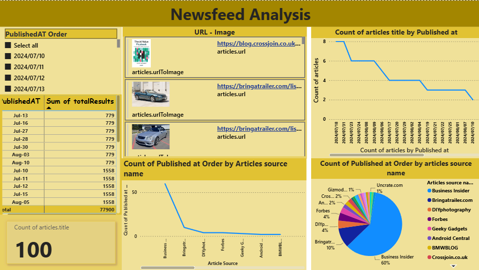

# Newsfeed Analysis — Power BI

A Power BI dashboard that analyses newsfeed data to show which sources dominate coverage and how publishing volume trends over time, supporting data-driven media decisions.



---

## Business question

Which news sources dominate the feed, and how does article volume change over time?

## Key insights

- **100 articles** analysed from July–August 2024.
- **Business Insider** is the dominant source at **60%** of all articles.
- **Bringatrailer** follows at **10%**, then a long tail of smaller sources (Forbes, DIYphotography, Geeky Gadgets, Android Central and others) at under 5% each.

## Dataset

| Item | Detail |
|---|---|
| Source | <!-- TODO: e.g. "NewsAPI.org JSON response" --> |
| Period | July – August 2024 |
| Grain | One row per article |
| Main fields | `title`, `url`, `urlToImage`, `publishedAt`, `source.name` |

## Approach

1. **Load** – imported the newsfeed data into Power BI Desktop.
2. **Transform (Power Query)** – expanded the nested article records into columns, set data types, and created a published-date column plus a sort-order column so dates display in the right order.
3. **DAX measures** – built dynamic measures for article count and percentage share by source.
4. **Visualise** – built the report page below.

| Visual | What it answers |
|---|---|
| Date slicer & date table | Filter and browse by published date |
| URL + image cards | Preview each article with its thumbnail and link |
| KPI card – Count of articles | Total articles in the selected period |
| Line – Articles by published date | Publishing volume over time |
| Line – Articles by source | Ranking of sources by volume |
| Pie – Share by source | Each source's % of total coverage |

## DAX measures

<!-- TODO: paste your measures from the .pbix here (Modeling → select measure → copy formula) -->
```DAX
-- Total Articles = ...
-- % Share by Source = ...
```

## Repository contents

```
newsfeed-analysis-powerbi/
├── README.md
├── dashboard/
│   ├── newsfeed-analysis.pbix    # Power BI file
│   └── newsfeed-analysis.pdf     # PDF export for quick viewing
├── data/
│   └── newsfeed-data.json        # source data (or .csv)
└── images/
    └── dashboard.png             # screenshot used above
```

## How to view

- **No Power BI?** Open `dashboard/newsfeed-analysis.pdf`.
- **With Power BI Desktop** (free, Windows): download the `.pbix` file and open it. If prompted, point the data source to the file in `data/`.

## Tools

Power BI Desktop · Power Query · DAX

---

**Surya V Vakade** — SAP FICO · Finance & Analytics
[LinkedIn](https://www.linkedin.com/in/surya-vv) · [GitHub](https://github.com/suryavakade-1745)
